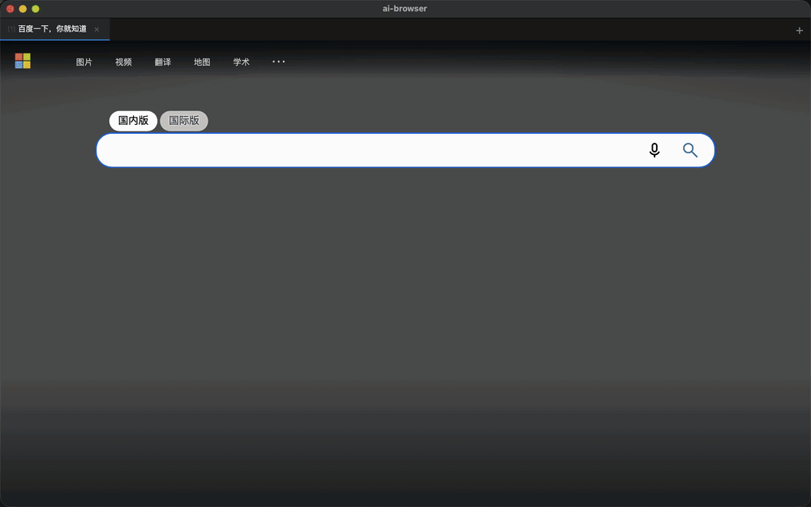
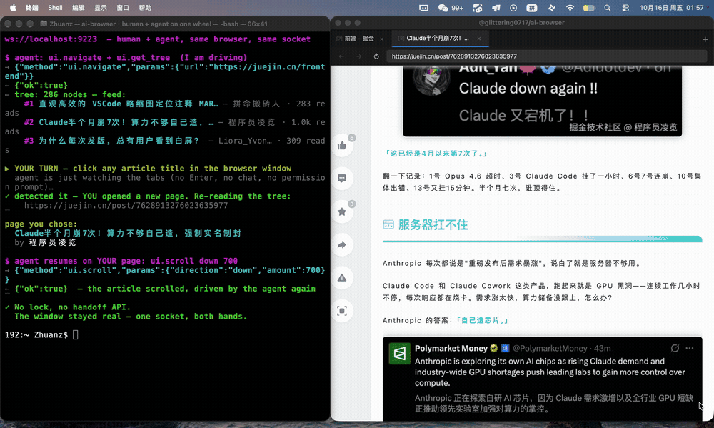

<h1 align="center">AI Browser</h1>

<p align="center">
  <b>中文读者请看这里：<a href="README-CN.md">README-CN.md（3 分钟速读 + 中文安装指引）</a></b>
</p>

<p align="center">
  <b>A real browser whose only operator is your agent.</b><br>
  It reads pages as a semantic tree instead of screenshots, acts through trusted browser input —
  and because it is a normal, visible Electron window, a human can reach for the mouse at any time.
</p>

<p align="center">
  
  
  
  
  
  
</p>

<p align="center">
  <em>A noisy real-world feed (300+ accessibility nodes) becomes a typed structure — then one <code>ui.act</code> switches the feed and the tree changes with it. Every call is a raw JSON-RPC message over one WebSocket: no SDK, no coordinates.</em><br>
  <a href="docs/marketing/demo.gif"></a><br>
  Reproduce: <code>npm start</code> then <code>node examples/feed-tree.mjs</code>
</p>

<p align="center">
  <em>Human + agent, same browser, same socket. The agent drives, then simply stops and watches; a person clicks an article in the real window, the agent notices the new tab on its next read, and continues on the page the human chose. No lock, no hand-off API.</em><br>
  <a href="docs/marketing/demo2.gif"></a><br>
  Try it yourself: <code>npm start</code> then <code>node examples/human-takeover.mjs</code> — click anything when it says <em>YOUR TURN</em>.
</p>

**What it is.** An Electron app that exposes its tabs over two equivalent interfaces — an MCP server
(20 `browse_*` tools) and a raw WebSocket JSON-RPC API (`ws://localhost:9223`, methods `ui.*`). Your
agent navigates, reads a structured semantic tree (`role` / `label` / `value` / `states` / `actions`),
and clicks or types by `data-ai-id`. There is no screenshot step and no OCR: `src/` contains no
capture call at all.

**What it is not.** It is not headless. The window really opens, really renders, and stays interactive —
see [Letting a human step in](#letting-a-human-step-in). Nor does it "co-drive" with you: the hand-off
is a conversation between the agent and the user, not a browser API.

> **Security note.** The WebSocket server has no authentication — it listens on localhost and trusts
> whoever connects. Do not expose port 9223 beyond loopback, and avoid untrusted networks.

---

## Install

**Install the prebuilt package unless you have a reason not to.** Option A is one file you
double-click: no Node.js, no dependency tree, no build step. Source install (Option C) pulls a
~276 MB `node_modules` plus a ~100 MB Electron engine download on top — only use it when no
package fits your platform, the package misbehaves, or you specifically need to run from source.

### Option A — macOS install package (recommended)

Grab `AI-Browser-<version>-arm64.dmg` from
[GitHub Releases](https://github.com/Glittering/ai-browser/releases) (~110 MB to download,
~245 MB on disk — most of it is the bundled Chromium engine, which *is* the product). Open the
dmg, drag **AI Browser** to `/Applications`, launch it. Done.

Two things to know before you download it:

- **It is not notarized.** macOS Gatekeeper will refuse to open it on the first try. Right-click
  the app → **Open**, confirm once, and it runs normally afterwards. (A paid Apple Developer
  account is what removes this step; until then, this is the honest cost.)
- **Only macOS `arm64` is built.** Windows and Linux have no package yet, because neither has
  been verified on this project — see [Compatibility](#compatibility).

Agents still connect through the MCP server (Option B below), and the two channels cooperate:
when the packaged app is already running, the MCP server finds it on port 9223 and **reuses it
instead of spawning a second copy of Electron** — one browser, one login session, whichever way
you start it. So "package for the engine + `npx` for the MCP bridge" is the normal agent setup
too.

### Option B — npx (the agent channel)

The package is published as [`@glittering0717/ai-browser`](https://www.npmjs.com/package/@glittering0717/ai-browser);
no clone needed:

```bash
npx -y @glittering0717/ai-browser --help
```

To open the visible browser window directly:

```bash
npx -y @glittering0717/ai-browser start
```

Requires **Node ≥ 18** and a desktop session (this is a GUI app). If a launch needs its own
engine, the first run prepares it (~100 MB, downloaded once). npm ≥ 11 blocks dependency install
scripts by default — the launcher detects that and runs Electron's own downloader itself, so
nothing extra is needed. If the download from GitHub releases is slow or blocked (common on
mainland-China networks), point it at a mirror:

```bash
ELECTRON_MIRROR=https://npmmirror.com/mirrors/electron/ npx -y @glittering0717/ai-browser start
```

### Option C — from source (fallback)

Use this when there is no package for your platform, the package gives you trouble, or you need
to modify the code. It is the heaviest of the three: `npm install` pulls the full dependency
tree (~276 MB), then the Electron engine (~100 MB) on top.

```bash
git clone https://github.com/Glittering/ai-browser.git
cd ai-browser
npm install
```

If the Electron binary download is slow or fails outright, use the mirror:

```bash
ELECTRON_MIRROR=https://npmmirror.com/mirrors/electron/ npm install
```

Or make it sticky by creating a `.npmrc` in the project root:

```ini
electron_mirror=https://npmmirror.com/mirrors/electron/
```

Confirm the binary actually landed before blaming anything else — a missing binary still leaves
you with an "install that succeeded":

```bash
ls node_modules/electron/dist
```

To check the install end to end:

```bash
npm start
```

A 1280×800 window opens and the terminal prints `AI Browser WS server listening on ws://localhost:9223`.
(The first tab opens on the default start page; ignore it and navigate away.)

To build the package yourself:

```bash
npm install
node scripts/build_dmg.cjs              # current arch
node scripts/build_dmg.cjs --arch arm64 # or x64
```

Output lands in `dist/`. The script uses `@electron/packager` plus macOS's built-in `hdiutil`
(no external binary downloads); the reasoning — including why `electron-builder` refuses to build
this project — is documented in
[`docs/DEPENDENCY_AND_DISTRIBUTION_AUDIT.md`](docs/DEPENDENCY_AND_DISTRIBUTION_AUDIT.md).

---

## Connect your agent

Add this to your MCP client's config file — Claude Desktop's config, `~/.cursor/mcp.json`, or a
project-level `.mcp.json`:

```json
{
  "mcpServers": {
    "ai-browser": {
      "command": "npx",
      "args": ["-y", "@glittering0717/ai-browser", "mcp"]
    }
  }
}
```

A ready-made copy sits in [`examples/mcp-config.json`](examples/mcp-config.json). From-source users
can instead point `command: "node"` at `/absolute/path/to/ai-browser/src/main/mcp_server.js`.

**You do not need to start the browser yourself.** On the first `browse_*` call the MCP server probes
port 9223; if nothing is listening it spawns Electron detached and waits up to 30 seconds for the
WebSocket server (the very first call may additionally spend time preparing the engine). If you would
rather keep one long-lived window shared by every client, launch the **AI Browser** app you installed
in Option A (or run `npx -y @glittering0717/ai-browser start`, or `npm start` from source) — a second
launch just focuses the existing window.

`examples/AGENT_INSTRUCTIONS.md` has a copy-paste prompt you can drop into a `CLAUDE.md`, Cursor Rule,
or any system prompt; it teaches the tool loop, the token-saving params, and when to ask a human.
Agents installing this themselves (Cline, etc.) can read the short machine-oriented
[`llms-install.md`](llms-install.md) instead of this README.

---

## The MCP tools

Source of truth: [`src/main/mcp_tools.js`](src/main/mcp_tools.js). There are 17 — a deliberately
small surface, since every tool schema is injected into your agent's context on every turn.

| Tool | One line |
|---|---|
| `browse_navigate` | Load a URL in the active (or given) tab. |
| `browse_get_tree` | Read the page as a semantic tree + page context (modals, messages, stats). |
| `browse_act` | `click` / `type` (append at caret) / `setContent` (replace all) / `clear` / `focus` / `hover` / `scroll_to` / `upload` / `get_value` (read-only) / `drag` / `press` / `wheel` on a `data-ai-id`. |
| `browse_diff` | `snapshot` a baseline, then `diff` to get added / removed / changed paths with before/after values. **This is how you prove an action did anything.** |
| `browse_capabilities` | Probe what a page affords and which route to take on it (see below). |
| `browse_repaint` | Force the compositor to redraw the tab when the window shows a stale page; returns `repaint_count`. |
| `browse_downloads` | List a tab's downloads with their on-disk paths. Downloads are asynchronous — poll this after clicking an export button. |
| `browse_canvas` | Read `<canvas>` through captured draw calls: `list` / `read` / `configure` / `capture`. **Experimental — see the canvas section below.** |
| `browse_evaluate` | Run a JS *expression* in page context (5000-char cap, Node identifiers rejected). |
| `browse_scroll` | Scroll the page, or scroll an element into view. |
| `browse_wait` | Poll until `button_enabled` / `modal_appeared` / `text_contains` / `url_contains`. |
| `browse_tabs` | Tabs: `list` / `new` / `close` / `switch`. `switch` sets the default target for later calls. |
| `browse_network` | Chrome-DevTools-style network inspection: `list` (filter by method / URL / status / type), `get` (request + response headers and bodies), `clear`, `configure`. |
| `browse_quit` | Shut the whole browser down and release the process. |

### What every act result already tells you: `effect_state`

`browse_act` no longer leaves you guessing whether your input reached the page. Every result
carries an explicit verdict:

| `effect_state` | Meaning | `retry` |
|---|---|---|
| `committed` | dispatched and acked by the page | `no` |
| `none` | provably nothing happened (no such target, bad params, CDP down) | `safe` |
| `unknown` | cannot prove nothing happened — timeout, paste dispatched but never consumed, half a key sequence | `verify_first` |

The default is `unknown`, not `none`: when the browser cannot tell, it says so. Retrying an
`unknown` blindly is how a form gets submitted twice — read the page first. `unknown` results
also carry a one-sentence `effect_hint` saying exactly that.

When a `target` cannot be found, the result adds `stale_ref` / `ref_epoch` / `tree_epoch` /
`ref_diagnosis`, because "no such target" hides three very different situations:

- `ref_diagnosis: "stale"` — the page was re-read after you took that ref (`ref_epoch` <
  `tree_epoch`). Get a fresh one; retrying the same ref will keep failing.
- `ref_diagnosis: "never_seen"` — the ref has never been in any tree read so far. Re-reading
  will not help: wrong value (visible text instead of a `data-ai-id`), a typo, or another tab's ref.
- `ref_diagnosis: "present_in_tree"` — in the current tree but not found in the DOM: iframe,
  shadow root, or a detached node.

All three report `effect_state: "none"` (nothing happened) with `retry: "verify_first"` — no side
effects, but repeating the identical call is pointless.

### Prove it happened: `browse_diff`

A tool reporting `success` is **not** evidence that anything changed — the browser will happily
tell you a click landed on an element that ignored it, a drag completed when the app snapped the
node somewhere else entirely, or a keystroke went into a field that then cleared itself. Every
write should be wrapped in a snapshot/diff pair:

```js
const base = await browse_diff({ operation: "snapshot", js: "app.graph.serialize()" });
await browse_act({ action: "click", target: "e:button-25" });
const d = await browse_diff({ operation: "diff", snapshot: base.snapshot });
// d.verdict === "changed"
// d.changed_paths → [{ path: "nodes[7].widgets.steps", from: 20, to: 21, reason: "value" }]
```

- `verdict` is an explicit `"changed"` / `"unchanged"`, so "nothing happened" is never inferred from
  an empty array you might have built wrong.
- Every entry carries a `path` plus **both** values, so you can check *why* it changed.
- Arrays are compared **element-wise by index**, not as sets: a moved node reads as changed entries,
  never as "one removed + one added" (which would look like two events instead of one reorder).
- Float noise is tolerated (`201354.48743718592` vs `...1859` is *not* a change), but a real 22-unit
  coordinate shift is.
- Omit `js` for a **site-agnostic DOM snapshot** — role / label / value / disabled / size per
  element plus the page's visible text. No per-site JS required, and plain `<div>` status text
  changes are caught.
- Omit `js` and it **also fingerprints the app's own data model** when the page hangs one off
  `window`. A canvas-rendered app's DOM is a still photograph — dragging a node or editing a
  widget repaints `<canvas>` and moves nothing the element walk can see, so a DOM-only diff
  answers `unchanged` to a write that demonstrably happened. ComfyUI's documented write path
  (`node.widgets[].value`) moved the DOM by exactly zero bytes. With the fingerprint, that same
  write shows up as `model.fp` (and `model.count` when the node count moved). It is read-only
  (`loadGraphData` is a loader and is never called), it picks whichever candidate can actually be
  read back rather than whichever *looks* most promising, and a library namespace — which scores
  well on names and has no model to hand back — is skipped.
- `rearm: true` moves the baseline forward for the *next* diff, so you can loop "assert nothing
  changed" across many steps; `forget: true` drops it.
- A throwing expression, a missing id, or a cross-tab comparison all return an explicit error.
  They never degrade into an empty snapshot, which would make every subsequent diff report
  "unchanged" — the one failure mode that turns all verification into false green.

### Which route on this page? `browse_capabilities`

Before improvising on an unfamiliar site, ask. One call reports the semantic-tree size and its
role/action histogram, canvas count, same-origin iframes and their internal size, objects the app
hangs off `window` (auto-detected by shape: `has .graph` / `._nodes` / `getState` / `serialize`),
the JSON endpoints it has already called, and a **recommended route with the evidence for it**:

- `L1_structured_data` — the app exposes its own model; read and write the whole graph as JSON.
- `L2_semantic_tree` — enough elements to find targets by role/label and drive them by `data-ai-id`.
- `L3_pointer_gestures` — only for what has no structured path (drag a node, draw a connection,
  wheel pan/zoom). Always follow with `browse_diff`.

It also flags traps explicitly: "the body is in a same-origin iframe" or "there are 7 canvases but
only 17 semantic elements — stop trying to hit canvas-drawn items with coordinates and go find the
data model instead".

Notes that save round-trips:

- `browse_get_tree` accepts `subset: "interactive"` to drop layout-only branches, `mode: "diff"` to
  return only nodes that appeared/disappeared since the last read, and `ax: true` to read through the
  accessibility layer (links then carry `url`).
- **`type` appends; `setContent` replaces.** They used to be identical (both replaced the whole
  content), which made incremental editing impossible — insert a Weibo-style topic tag and the next
  `type` wiped it. Now `type` writes at the caret (`params.at`: `end` (default) / `start` /
  `cursor`), so "insert a topic, then keep writing the body" works. To refill a field, use
  `setContent` (or `clear` first).
- `browse_act` also takes `action: "get_value"` — a **read-only** way to fetch an element's full text,
  which matters because `browse_get_tree` truncates long values at 200 characters (see below).
- **Pointer gestures are first-class**: `drag`, `press` and `wheel`. Canvas / board / sortable UIs are
  built on them, and no amount of `evaluate` can substitute — synthetic `PointerEvent`s do not move a
  framework that uses Pointer Capture (measured on a React Flow canvas: the node's position changed by
  exactly 0,0), so these go through CDP trusted input.
  - `drag`: `dx`/`dy`, `to_x`/`to_y`, or `to_target` (drop onto another element). `from_anchor`
    / `to_anchor` (`left`/`right`/`top`/`bottom`/`center`) grab a side — a side prefers that element's
    connection handle, **but only if the handle is actually hit-testable** (see the note below).
    `from_x`/`from_y` start from a bare point (panning empty canvas), in which case no `target` is needed.
  - `press`: `key` (`Delete`, `Escape`, `ArrowRight`, `Enter`, … or a combo like `"Meta+a"`), or `keys`
    for a sequence. Deleting a node, undo, deselection — all keyboard-only.
  - `wheel`: `delta_x` / `delta_y` plus `hold: ["Control"]` for canvas zoom. **`browse_scroll` cannot do
    this** — it calls `window.scrollBy`, which an infinite canvas ignores entirely.
  - The drag result reports `drag_from` / `drag_to` **and** which element actually sits at each point
    (`from_at_id`), plus `warning` + `start_hit_target: false` when the press landed on a *different*
    element — visual overlap otherwise looks exactly like "drag does nothing".
- **`actions` is inferred from behaviour, not from `role`.** An element whose computed `cursor` is a
  drag cursor, or that has `draggable="true"` / `cursor: pointer` / an `onclick`, now advertises
  `drag` / `click` in the tree even when its role is `group`. Without this, a canvas full of
  `role: group` nodes reported `actions: []` and the agent could not tell they were interactive at all.

---
- `browse_network` captures requests from the moment a tab opens, **including POST request bodies** —
  no subscription needed. Request headers are redacted by default
  (`authorization` / `cookie` → `[REDACTED]`); pass `include_sensitive_headers: true` to see them.
- Most tools take an optional `tab` for multi-tab work; without it they target the active tab.

---

## Letting a human step in

### It does not steal your focus — and it does not need a window at all

The agent works fine while the window is in the **background**, minimised, or **not shown at all**.
CDP trusted input (`Input.dispatchKeyEvent` / `Input.dispatchMouseEvent`) does not need the window to
be frontmost, and the app runs with `disable-backgrounding-occluded-windows`,
`disable-renderer-backgrounding` and `disable-background-timer-throttling`, so a hidden window is
neither throttled nor losing events. Every tab also gets `setBackgroundThrottling(false)` from birth.

Three things used to make "run it in the background" impossible, and all three are fixed:

- `new_tab` / `set_active_tab` dragged the window to the front on every call (they called
  `webContents.focus()`). They no longer do. The page still *thinks* it is focused —
  `Emulation.setFocusEmulationEnabled` keeps `document.hasFocus()` and focus-dependent lazy-loading
  behaving normally — while your keyboard focus stays wherever you left it.
- Any action **un-hid** a hidden window (`auto` restored it with `showInactive()`), so "hidden" was
  never a steady state: the window crept back up every time the agent clicked something. Visibility is
  now driven only by you (Dock icon) or by an explicit `ui.window` call.
- A tab that was never attached to the window had **no compositor surface**: reading, clicking and
  typing worked, but `screenshot` returned 0 bytes and `paint_check` reported `no-frame` — a black box.
  All tabs are now attached and z-ordered (`setTopBrowserView`), so a background tab renders and can be
  screenshotted.

```bash
AI_BROWSER_START_HIDDEN=1 npm start   # run with no window at all; click the Dock icon to bring it up
AI_BROWSER_FOCUS=always npm start     # pre-1.2 behaviour: show + moveTop + focus on every action
AI_BROWSER_FOCUS=never npm start      # same as the default now: never touch window state
```

While it is hidden, everything still works — read the tree, click, type, scroll, upload, download,
answer dialogs, capture network, screenshot, `paint_check`. Click the Dock icon at any moment and the
window appears showing the tab *you* were looking at; the agents keep working on theirs.

`npm run focus` asserts the focus behaviour **from the outside** (macOS `lsappinfo`, no accessibility
permission needed) with a deliberate control group configured to steal focus, so the suite goes red if
the measurement ever stops working instead of passing vacuously. `npm run background` covers the
window-hidden half: it boots with `AI_BROWSER_START_HIDDEN=1` and runs the full capability slice
against a window that never appeared.

> Note on `document.hasFocus()`: it returns `true` even when the window is in the background, because
> `Emulation.setFocusEmulationEnabled` is deliberately on — that is what keeps focus-dependent
> lazy-loading and animations from stalling. So it is **not** a valid way to detect "am I in the
> foreground"; the test uses the external observer instead.

### Several agents at once

Each WebSocket connection (each MCP process) gets **its own working tab**. When a call omits `tab`,
the target is resolved as `explicit > your tab > the tab the human is looking at > the first tab`, so:

- `browse_tabs {"op":"new"}` opens a tab **without** taking over the user's view (`show:true` when you
  want them to look at it). The single exception is the untouched start page — otherwise the user
  would sit staring at a blank homepage while the agent works.
- `browse_tabs {"op":"list"}` marks your own tab with `mine: true`.
- If **someone else** closes your tab, your next call fails with `-32001` instead of silently running
  on their page. Closing your *own* tab falls back to the visible one, like a normal browser.
- Tabs opened by a click (`target=_blank`) move your **target** to the new tab; they only move the
  user's **view** if the tab they were watching is the one that opened them.

Different tabs run fully in parallel. Two agents typing into the *same* field is not coordinated —
the write-verification will honestly report `input not verified` rather than pretending both landed.

`npm run multiagent` drives two connections against one browser and asserts all of the above,
including 10 interleaved actions with no cross-contamination.

### Tab groups: every agent gets its own corner

Targets are per-connection, but tabs still shared one strip — you could not tell whose tab was whose,
and nothing stopped an agent from opening twenty of them. Both are fixed by **ownership**:

```
group = 'human' | 'agent:<session>'
```

An agent declares itself with `ui.hello` (the MCP server and the CLI both do it on connect). From then
on, the **first** call that touches a page and has no target yet gets a blank tab of its own, in its own
group, and a one-time hint in the result:

```json
{"workspace": {"tab": 7, "group": "Claude", "created": true, "hint": "..."}}
```

So an agent **never** defaults to the tab you are looking at. Reading your page is still possible and
still cheap — `browse_tabs {"op":"list"}`, find the entry with `group: "human"`, pass its `tab`
explicitly. Reading does not take it over.

In the tab strip your tabs stay as they were; each agent group collapses into a pill (its colour, name
and tab count), expands on hover, pins on click, and stays expanded while you are looking at one of its
tabs. Clicking a tab inside a group only changes what **you** see — it does not change the agent's target.

Each group is capped (8 by default, `AI_BROWSER_TAB_LIMIT`). Opening past the cap is **refused**, not
"quietly evicted", with the list of tabs you could close:

```
-32001 your tab group is full (8/8) — close one before opening another
data: { reason: "group-full", limit: 8, tabs: [{tab, url}, ...] }
```

Popups cannot be refused (the page's script is waiting for the window), so in that one case the least
recently used tab in the group — never the visible one, never one with a dialog open — is closed
instead, and reported in `browse_tabs {"op":"list"}` as `evicted`.

`npm run multiagent` (46 checks) covers it, M7–M9: auto workspace, the cap and its refusal payload,
and that one full group does not affect anybody else's.

---

This is the part most easily misunderstood, so plainly: **the agent drives the browser, and the human
can always take over the window.**

Because it is a real Electron window, a person can click, type, scroll, and log in exactly as they
would in Chrome — with the mouse and keyboard, at any moment, with no permission to request. That
covers the things an agent genuinely cannot do:

- **Login / SSO** and anything behind a password the agent shouldn't have
- **QR-code scans** (app-to-web authorization)
- **Slider and image CAPTCHAs**, SMS or email codes
- **Payment confirmation**, risk-control interstitials, OTP screens
- Anything where continuing would mean fabricating credentials

**How the hand-off works: there isn't one — in the browser.** Nothing coordinates it on AI Browser's
side, and nothing needs to. It is a conversation between the agent and its user:

1. The agent hits something it cannot do.
2. It says so in chat, plainly: *"Please scan the QR code in the browser window, then reply 'done'."*
3. It stops and waits for the reply — no retry loops on clicks that cannot work.
4. After "done" it re-reads with `browse_get_tree` to confirm the new state, then continues.

See [`examples/with-human.mjs`](examples/with-human.mjs) for the scripted equivalent: it prints a
prompt and waits for Enter over `readline`. The browser has no idea any of that happened.

Two practical consequences for the agent:

- **Never call `browse_quit` while a human is working in the window.** It tears down the window and
  exits the process — anything half-solved is lost. Quit when the task is finished, not before.
- **Login state persists.** Tabs live in the `persist:ai-browser` session partition, so cookies and
  sessions survive a restart; usually a human only has to step in once per site per machine.

---

## Raw WebSocket API

MCP is a thin stdio adapter. Anything MCP can do is reachable directly over JSON-RPC 2.0 at
`ws://localhost:9223` from any language. Source of truth: the method switch in
[`src/main/ws_server.js`](src/main/ws_server.js).

You do not have to write a client to do this. The CLI speaks the same protocol:

```bash
ai-browser status                                   # running? pid / port / tabs
ai-browser call ui.list_tabs
ai-browser call ui.get_tree '{"subset":"interactive"}'
ai-browser call ui.navigate '{"url":"https://example.com"}'
echo '{"url":"https://example.com"}' | ai-browser call ui.navigate -
```

`call` prints the raw `result` as one line of JSON (pipe it into `jq`), exits `0` on success,
`1` when the call failed, `2` on a bad command line. `--port`, `--timeout`, `--pretty` are available.

So there are three doors to one implementation — MCP stdio (`ai-browser mcp`), JSON-RPC over
WebSocket, and this CLI. None of them is a separate code path.

| Method | Purpose | Maps to |
|---|---|---|
| `ui.get_tree` | Semantic tree (+ context). Params: `focusedOnly`, `ax`, `subset`, `mode`, `tab` | `browse_get_tree` |
| `ui.act` | `params.action` + `params.target`; per-action args nested under `params.params` | `browse_act` |
| `ui.navigate` | Load a URL (`params.url`, optional `tab`). Returns `{ok, error?}` — `{ok:false}` always carries a reason. | `browse_navigate` |
| `ui.snapshot` / `ui.diff` | Capture a baseline (`params.js`, optional `label`) and diff against it (`params.snapshot`, `rearm`, `forget`) | `browse_diff` |
| `ui.capabilities` | Probe the page: tree histogram, canvas, iframes, app globals, endpoints, recommended route | `browse_capabilities` |
| `ui.repaint` | Force the compositor to redraw a tab; returns `repaint_count` so a repaint is provable | `browse_repaint` |
| `ui.evaluate` | Run JS in page context, same guard as MCP | `browse_evaluate` |
| `ui.scroll` | Scroll page or element (`direction`, `amount`, `target`). **Document scrolling only** — for canvas apps use `ui.act{action:'wheel'}`. | `browse_scroll` |
| `ui.wait` | Poll until a condition or timeout | `browse_wait` |
| `ui.new_tab` / `ui.close_tab` / `ui.list_tabs` / `ui.set_active_tab` | Tab management (the four are merged into `browse_tabs{op}` on the MCP side) | `browse_tabs` |
| `ui.subscribe` / `ui.unsubscribe` | Event subscription; `params.events`, `"*"` for all | — (WS only — see below) |
| `ui.downloads` | This tab's downloads with on-disk paths (`state`, `received_bytes`, `dir`) | `browse_downloads` |
| `ui.get_focused` | The focused element subtree | — |
| `ui.peek` | Hover a folded/hover-only affordance and return what appeared/disappeared (`revealed` / `hidden`), without committing. Ids are real `data-ai-id`s you can hand straight to `ui.act`; `revertMs: 0` keeps the mouse there so you can click what it found | — |
| `ui.network_body` | Response body by URL substring (`url_pattern`) | — (superseded by `browse_network`) |
| `ui.quit` | Graceful shutdown | `browse_quit` |

Note two differences from the MCP spelling, both visible in the switch above: it is `focusedOnly`
(camelCase), not `focused_only`; and `ui.act` nests its per-action arguments under `params.params`.
`ui.subscribe` / `ui.unsubscribe` are also valid as notifications with no `id`.

`ui.subscribe` is deliberately **not** exposed as an MCP tool: MCP's stdio path drops
server→client notifications, so an MCP caller would subscribe and then never receive a single
event. Real-time events are a raw-WebSocket capability only. For anything pull-based, use
`browse_network` instead.

```js
import WebSocket from 'ws';

const ws = new WebSocket('ws://localhost:9223');
let id = 0;
const call = (method, params) => new Promise((resolve, reject) => {
  const myId = ++id;
  const onMsg = (raw) => {
    const m = JSON.parse(raw.toString());
    if (m.id === myId) { ws.off('message', onMsg); m.error ? reject(new Error(m.error.message)) : resolve(m.result); }
  };
  ws.on('message', onMsg);
  ws.send(JSON.stringify({ jsonrpc: '2.0', id: myId, method, params }));
});

ws.on('open', async () => {
  await call('ui.navigate', { url: 'https://example.com' });
  const { tree } = await call('ui.get_tree', { subset: 'interactive' });
  console.log(tree.role, tree.children?.length);
  ws.close();
});
```

Error codes follow JSON-RPC: `-32700` parse error, `-32601` unknown method, `-32602` invalid params
(the `ui.evaluate` guard returns this), `-32603` internal error.

---

## How it works

```
   agent ── MCP stdio (17 browse_*) ──┐
   agent ── WS JSON-RPC :9223 (ui.*) ─┤
                                      ▼
 ┌──────────────────────────────────────────────────┐
 │ Electron main                                    │
 │   index.js        window · tab strip · watchdog  │
 │   ws_server.js    JSON-RPC routing, event stream │
 │   page_manager.js tabs · id-matched IPC · CDP    │
 └───────────────┬──────────────────────────────────┘
                 │ IPC (request-id matched)
 ┌───────────────▼──────────────────────────────────┐
 │ preload (contextIsolation:true, nodeIntegration:false)
 │   bridge.cjs · extractor.cjs · actions.cjs ·     │
 │   watcher.cjs  (captcha / message / state scan)  │
 └───────────────┬──────────────────────────────────┘
                 ▼
              live DOM → semantic tree
```

**Reading.** Each node in the returned tree carries a `data-ai-id` — the element's own DOM `id` when it
has one, otherwise a generated `e:tag-N`. Ids are **stable across reads**: an element that already
carries one keeps it, and generated ids come from a monotonic counter, so inserting an element above
others does not renumber them. (It used to: a stale id then silently resolved to a *different* element,
and the act reported success while hitting the wrong thing.) They reset on navigation. Alongside the id
come `role`, `label`, `value`, `states`, and `actions`, plus a `context` block — open modals, transient
messages, required-field hints, coarse stats. Two read paths exist: the default preload extractor, and
the accessibility layer behind `ax: true` (which additionally gives links their `url`).

The first read of a page annotates elements with `data-ai-id`; that is the one write a *read* performs,
and it is what makes later acts resolvable. **Repeat reads write nothing.** An attribute is only set
when its value actually changes, because real Chromium delivers a `MutationObserver` record even when
you set an attribute to the value it already holds — measured at 4001 records per read on a
4000-element page before this guard existed. A read that spams the page's own observers is a read that
perturbs the thing it is measuring.

**Writing.** Actions are **trusted browser input**, not synthesized JS. The main process drives the
page over the Chrome DevTools Protocol — `Input.dispatchMouseEvent` for clicks, and per-character
`Input.dispatchKeyEvent` (`rawKeyDown → char → keyUp`) for typing — then validates that the click
actually landed via `elementFromPoint` (piercing shadow roots: the plain call returns the *host* for
anything inside a web component, which silently downgraded every such click to a synthetic one).
Because the events arrive as real keyboard and mouse input,
Draft.js, ProseMirror, CKEditor, Quill, and plain `<textarea>` all work through the same path without
per-framework branches.

**Where it is thin.** `extractor.cjs` is a heuristic over the DOM, not a clean-room specification: it
handles ordinary pages well and will mislabel exotic ones. The window runs with hardware acceleration
off plus three Chromium switches
(`--disable-backgrounding-occluded-windows`, `--disable-renderer-backgrounding`,
`--disable-background-timer-throttling`) so that an IDE window on top of the browser doesn't cause
injected input to be silently dropped.

---

## Examples

Runnable scripts live in [`examples/`](examples/) and connect straight to `ws://localhost:9223`:

| File | What it shows |
|---|---|
| [`mcp-config.json`](examples/mcp-config.json) | Minimal MCP client config; replace the placeholder path. |
| [`AGENT_INSTRUCTIONS.md`](examples/AGENT_INSTRUCTIONS.md) | Copy-paste instructions for your agent, incl. the human hand-off protocol. |
| [`raw-ws.mjs`](examples/raw-ws.mjs) | Smallest possible raw WebSocket client. |
| [`read-page.mjs`](examples/read-page.mjs) | Load one page, print its interactive elements. |
| [`feed-tree.mjs`](examples/feed-tree.mjs) | Crowded feed → typed structure → act, all over raw JSON-RPC (top demo). |
| [`with-human.mjs`](examples/with-human.mjs) | Full flow for when a human has to step in. |
| [`human-takeover.mjs`](examples/human-takeover.mjs) | Agent pauses, you click, agent resumes on your page (second demo). |

```bash
node examples/read-page.mjs
```

---

## Troubleshooting

**The page updated but the window still shows the old one.** This used to require clicking tabs
back and forth, because the only thing that forced the compositor to redraw a `BrowserView` was
`setActiveTab` doing `removeBrowserView` + `addBrowserView` + `setBounds` — navigation never did it.
Now every navigation signal triggers it: `did-navigate`, `did-navigate-in-page` (SPA route changes
fire no load event at all), `did-frame-finish-load` (a canvas editor inside an iframe boots long
after the top document finished), plus window `show` / `restore` / `focus` — which matters here
because this window is designed never to steal your focus, so it sits behind your editor for
minutes at a time. If it still looks stale, `ui.repaint` forces it on demand and returns
`repaint_count` so you can confirm a repaint actually happened.

**An action reported success but nothing changed.** Two causes worth knowing:

- Over raw WS, `ui.act` nests its per-action arguments under `params.params` — `{action:"type",
  target:"<id>", params:{text:"…"}}`. Flattening it to `{text:"…"}` passes an empty string, which
  used to hit the idempotent short-circuit and report `success` with nothing typed. It now returns
  an explicit error instead.
- Sometimes the action genuinely did nothing (an overlay ate the click, the app reverted the
  change). That is what `browse_diff` is for — wrap the write in a snapshot/diff pair rather than
  trusting the return value.

**An action never returns at all.** Every path that goes into the page is bounded by a deadline, so a
page whose main thread is blocked (a heavy recompute, a huge `JSON.parse`, a third-party script in a
loop) can never hang your tool call. Measured against a page that occupies its main thread for 120s:

| Call | Behaviour |
|---|---|
| `ui.get_tree` / `ui.get_focused` | errors at 5s (`getTree timeout`) |
| `ui.evaluate` | errors at 10s (CDP 5s, then the preload fallback's 5s) |
| `ui.act` | returns at 15s with `success:false, timed_out:true` |
| `ui.capabilities` | returns normally (~15s) |
| `ui.list_tabs` / `ui.network_list` | instant — they never touch the page |

`ui.act`'s budget scales with the work requested, so a legitimate long operation is not killed: `type`
/`setContent` budget `text.length × interval_ms`, `drag` budgets `duration_ms + steps`, `press`
budgets `repeat × interval_ms`, `clear` gets 20s. Override with `params.params.timeout_ms`
(1s floor, 300s cap) or globally with `AI_BROWSER_ACTION_TIMEOUT_MS`. A timeout explicitly warns that
**the action may have partially applied** — pointer already down, half the characters typed — so
re-read before retrying rather than firing the same write twice.

**The app restarts itself.** Electron's NetworkService can wedge as a whole: the port still listens,
every navigation fails with `ERR_FAILED`, and `curl` works fine. A watchdog probes from the main
process every 30s; after 5 consecutive failed sweeps it broadcasts `network_wedged` and relaunches
(the MCP client reconnects on its own). With a 5s per-request deadline that puts a genuine wedge at
roughly two minutes.

- Change what it probes: `AI_BROWSER_WATCHDOG_URLS=https://www.baidu.com/,https://example.com/`
  (comma-separated). The default is `example.com` **plus** `www.baidu.com`, and that plurality is
  deliberate — the network counts as alive if *any* target answers, so one flaky or geo-blocked host
  can't trigger a reboot loop. Never set a single target that your network can't reach.
- Turn it off entirely: `AI_BROWSER_WATCHDOG=0` (also accepts `off` / `false` / `no`).

**Port 9223 is already busy.** Another instance — often a stale one from an earlier session — owns the
port, or something else does. Either quit that instance, or move AI Browser off it:

```bash
AI_BROWSER_PORT=9224 npm start
```

Keep the port consistent across every client; both the app and the MCP server read
`AI_BROWSER_PORT` from `src/shared/config.js`.

**Electron is missing or launch fails immediately.** The ~100 MB engine never landed. With the npm
package, just launch again — the launcher downloads it itself (set `ELECTRON_MIRROR` for a slow
network, see [Install](#install)). From source, check `ls node_modules/electron/dist` and re-run
`npm install` with the mirror. Setting `AI_BROWSER_PORT` will not help here — this is a missing
binary, not a port conflict.

**Input is accepted but nothing happens.** Usually the window is occluded. The three
`disable-*-backgrounding` switches above exist to prevent it, but if you still see clicks that report
success while nothing moves, bring the AI Browser window to the front and try again.

**Login state keeps getting lost.** Sessions persist under `~/.ai-browser`. If you override it, note
that separate `AI_BROWSER_USER_DATA` directories are separate session stores — "logged in" in one is
not "logged in" in another:

```bash
AI_BROWSER_USER_DATA=~/.ai-browser-work npm start
```

**A red bar appeared at the bottom of the window.** That is a main-process exception — a bug in
AI Browser itself, not in the page you were driving. It is deliberately *not* a modal dialog: a
native `dialog.showMessageBox` is an `NSAlert` modal loop on macOS and blocks the whole main process
(measured: WebSocket calls got 4ms with no dialog vs **8 seconds of no response** with one), which
turned a self-healing JS exception into "every RPC timed out". The bar shows the message and the log
path, the process keeps running, and you can dismiss it with `×`.

Every exception is appended synchronously to `~/.ai-browser/logs/error.jsonl` (2MB × 4 rolling), with
the last 20 WebSocket calls attached so you can see *what was being done* when it broke. Read it over
the API with `ui.errors` / `browse_errors`, or just `tail` the file. A record of `boot` without a
matching `shutdown` means the process died hard last time.

If the exception happened before any window existed, the bar has nowhere to go, so it falls back to a
native box once (logged as `error_dialog_fallback`) rather than leaving you with a silently dead app.
Both paths are switchable: `AI_BROWSER_ERROR_BANNER=0` disables the bar, `AI_BROWSER_ERROR_DIALOG=1`
forces the modal box — the latter blocks the main process, so it is only for staring at a startup
crash on purpose.

### The element is clearly on the page but not in the tree

Before you write a site-specific script, work down this list. The reflex — "pin it with a
`querySelector` chain" — is what produced 142 site-specific scripts and 731 hardcoded selectors in
this project's own history, and almost none of them turned out to be necessary.

| # | Check | How | If it is the cause |
|---|---|---|---|
| 1 | Is it a **read-layer** gap? | `node tools/coverage_probe.cjs https://the.site/` | the tree is missing clickable elements → report it; the fix belongs in `src/preload/extractor.cjs`, not in your script |
| 2 | Is it an **action-layer** gap? | the node is in the tree, `ui.act` fails or does nothing | the element is readable but not reachable (iframe/OOPIF, canvas, trusted input, un-mounted input) → that is a browser-side fix too |
| 3 | Is it **timing**? | re-read the tree 2–3s later, or `wait_until` | the SPA simply had not rendered when you read it |
| 4 | Does it only exist **while hovered**? | `ui.peek { target, revertMs: 0 }` | the affordance is hover-rendered. `peek` hovers it and returns what appeared — pass `revertMs: 0` to keep it open, then `ui.act click` the id you got back |
| 5 | Is it **unnamed**? | `ui.peek`, or click it and read what shows up | an icon-only button the site gave no `aria-label`/`title`/`alt` cannot be named from nothing. But the panel it opens usually is named — so open it and read that instead of guessing which icon is which |
| 6 | Only now: **pin it yourself** | a selector in *your* script | keep it in your script. Do not encode it as "how this site works" — the next site will not match |

`coverage_probe` counts what a human would call click targets — elements the browser itself renders
with a hand cursor (`cursor:pointer`), where the pointer starts (not every descendant that inherits
it), and reports how many of them carry a `data-ai-id`:

```
$ node tools/coverage_probe.cjs https://www.csdn.net/
可点目标（手型边界）: 257
  ├ 自己带 data-ai-id（直接可操作）: 257 → 100%
  ├ 被单个交互后代盖满且它在树里（壳子，点内层等价）: 0
  ├ 祖先歧义（同一祖先下多个手型后代，点祖先指不准）: 0
  └ 整条祖先链无 id（真看不见）: 0
可用率（in_tree + by_desc + anc_only）: 100 % | 真缺口: 0
```

It exits non-zero below 80% so you can drop it into CI. Measured on 2026-10-17 (Baidu / Bilibili /
CSDN): **82% / 97% / 88%** before the click-boundary fix, **100% / 100% / 100%** after, at ~40ms
per `ui.get_tree`.

> **Those three numbers were measuring the wrong denominator.** Until 2026-10-19 the tool only
> counted the top document: on a page whose body lives in a cross-process iframe it reported
> "4 click targets, 100% usable, 0 gaps" while the entire course catalogue was invisible. It now
> measures every `frame-N` it can reach and **prints how many frames it could not** — an
> unmeasured area inside the denominator is worse than a wrong measurement. Re-measured
> 2026-10-19: Baidu 100%, CSDN 99% (8 cross-process frames now counted, 2 residual gaps),
> and the 超星 course page 82% with the 2 remaining gaps named explicitly. The write-up of this
> class of mistake — a metric that silently excludes the part that matters — is
> [`docs/POSTMORTEM_FRAME_VISIBILITY.md`](docs/POSTMORTEM_FRAME_VISIBILITY.md).

Two things the numbers do **not** cover, so you do not chase them: an element the page gives no
readable name (image-only links with no `alt` — 53% of Bilibili's clickable nodes) can never get a
label without inventing one, and a canvas has no DOM to read at all. Those are genuine boundaries,
not bugs. The full write-up, including why the first measurement of this was wrong by 3× (inherited
`cursor` inflates the denominator), is in
[`docs/AGENT_OPERABILITY_FEEDBACK.md`](docs/AGENT_OPERABILITY_FEEDBACK.md) §6.


---

## Test & dev

```bash
npm test             # vitest — 1024 tests across 73 files
npm run smoke        # Electron contract layer, offline fixture      — 31 checks
npm run capabilities # text fields, canvas, page source, network, DOM editing — 54 checks
npm run richtext     # rich-text editors, nested menus, forms, errors, tags, upload — 117 checks
npm run network      # request log, POST bodies, headers, pagination, redaction — 41 checks
npm run value        # value truncation contract + read-only get_value — 15 checks
npm run canvas       # canvas draw-call capture — 13 checks
npm run modeldiff    # canvas app data-model diff (the "unchanged" false green) — 12 checks
npm run audit        # every advertised action must exist; wait/downloads/permissions/quit — 35 checks
npm run nav          # address bar + load-failure error page (the "white screen" report) — 19 checks
npm run focus        # no focus stealing + full capability while backgrounded — 33 checks
npm run interact     # trusted drag / key press / wheel (pointer gestures) — 31 checks
npm run view         # viewport repaint budget + snapshot/diff verification — 29 checks
npm run dialog       # browser-level dialogs (native sheet blocks the renderer) — 15 checks
npm run wrapper      # "in the tree but won't click" = matched a container, not a link — 13 checks
npm run paint        # blank-page self-check: verdicts, bounded ladder, no false alarms — 23 checks
npm run layout       # geometry invariants + "no twitching" (zero extra repaints on nav) — 25 checks
npm run download     # "clicked download": viewable media must display, the rest must save — 23 checks
npm run multiagent   # several agents at once: own tab each, no cross-talk, gone tab errors — 46 checks
npm run background   # window hidden/minimized: every capability still works (headless-like) — 37 checks
npm run flicker      # frame-level: no frame may render the page shrunk (needs screen recording) — 6 checks
npm run e2e:all      # 一次跑完上面全部 22 个套件（每个独立端口）+ 可信汇总 — 743 checks
npm run verify:app   # boot the packaged /Applications app and assert on it — 22 checks
npm run realsites    # navigate/read/act against a matrix of real sites
```

All e2e suites boot a genuine Electron against offline fixtures and exit non-zero on failure.
Together they cover what jsdom structurally cannot: preload integrity, `ui.evaluate` under a strict
CSP, CDP click hit-testing, multi-tab lifecycle, event fan-out, and the `evaluate` guard rails.

**Each suite proves it is talking to the browser it just started.** Before any assertion runs it
calls `ui.server_info` and compares the returned `pid` against the child process it spawned; a
mismatch aborts with exit 4 instead of quietly producing results about somebody else's instance.
That gap was measured, not assumed: with an impostor WebSocket server holding the port, a suite
happily sent `ui.new_tab` / `ui.evaluate` / `ui.get_tree` to it and never noticed. Repro:
`REPRO_PORT=9799 node e2e/_repro_identity.cjs`.

`npm run e2e:all` also gives every suite its own port, because they share `/tmp/ai-browser-e2e-<port>`
as the profile and therefore Electron's single-instance lock too.

They all need the WS port free — stop a running `npm start` first, or point them elsewhere:

```bash
AI_BROWSER_PORT=9333 npm run smoke
```

They boot their own Electron in an **isolated profile** (`/tmp/ai-browser-e2e-<port>` by default), so
they never touch your real `~/.ai-browser` profile — the one holding your logged-in sessions. They
also clean up their Electron on exit, including on Ctrl-C / timeout / crash: an orphaned process
would otherwise hold the port and the single-instance lock, and you would find `npm start` refusing
to launch with *"another AI Browser instance is already running"*.

### What each capability suite proved

**`npm run view`** — the suite for the two things that quietly produce false confidence.

*Viewport.* A `BrowserView` can be fully loaded and still show stale pixels, and the only thing
that forced a repaint was switching tabs — which is exactly why "click the tabs a few times" used to
fix it. It now fires on every navigation signal and on window `show`/`restore`/`focus`. The suite
proves it from the **cumulative repaint counter**, not from a screenshot: a screenshot needs eyes, a
counter falsifies. It also proves the debounce doesn't self-trigger (a repaint loop would flicker
forever) and that repainting changes no page data.

*Verification.* `ui.diff` is only useful if it is right in both directions, so each assertion comes
in pairs: a real change **must** be reported *and* an unchanged page **must not** be. The negative
controls are the point — a diff that invented changes, or a snapshot that quietly became empty on
error (making every later diff report "unchanged"), would turn all verification into false green.
The suite also pins the failure mode where a mistyped parameter layer made `type` report success
without typing anything.

**`npm run richtext`** — the deepest suite. Rich-text editors and formatting, two- and three-level
nested menus, required vs optional fields (native `required`, `aria-required`, red asterisks),
error and warning surfaces (field-level, form-level, toasts, modal dialogs), radio / checkbox /
select / combobox, tag inputs and Weibo-style topic insertion, and image upload. Every
action assertion is checked against the **real DOM**, not just the semantic tree.

Two things it changed in the product:

- A click on a button that dismisses itself used to fire **twice** (the hit-test ran after the
  dispatch, found the target gone, and fell back to a second click). Duplicate submissions,
  duplicate mentions. Clicks now hit-test before dispatching and no longer fall back.
- Field-level errors used to be invisible — they are carried by bare `<span>`s with no ARIA role and
  were pruned as layout. They now surface in `context.errors` / `context.field_errors`, scanned
  across the whole document rather than only inside dialog containers.
- Three reads used to depend on a container's **class name**. Red asterisks were scanned only
  inside containers whose class happened to contain `modal`/`dialog`/`popup`/…, so a plain-page
  form's required fields were invisible; `modals[].fields[]` entries carried no `id`, so an error
  read for one field could not be mapped back to it; and auxiliary text in bare
  `<span>`/`<div>` (character counters, format hints) was pruned from the semantic tree with no
  second path at all. All three now sit at the **top level** of `context`: `required_hints` is
  scanned across the whole document, `fields[]` entries are shaped identically in `modals[]` and
  `forms[]` (`id` included, verified against the real DOM), and form-adjacent bare-span text lands
  in `hints` — the semantic tree itself keeps its pruning, so the token cost is unchanged.

**`npm run capabilities`** — typing into every kind of text field (plain inputs, `password`,
`number`, `textarea`, `contenteditable`, plus `readonly` / `disabled` / `maxlength` — including
**CJK input** and 1000-character text), reading page source, capturing response bodies, and editing
the page through `ui.evaluate`.

**`npm run network`** — that a POST can be captured with its full request body, that headers are
redacted by default, and that bodies paginate instead of being silently truncated. It also pins the
eviction rule: the retained byte budget is **global across tabs**, so a background tab quietly
filling it used to evict the body the agent was about to read on the *active* tab — the request
really happened and the body really was captured, it just got pushed out by someone else's noise.
Eviction now sacrifices non-active tabs first (including the background body being stored), and
`ui.network_configure` reports `active_tab` / `body_bytes` so a future `evicted` can be attributed
instead of guessed at.

**`npm run modeldiff`** — the suite for the one place `ui.diff` used to lie. A canvas-rendered app's
DOM is a still photograph: dragging a node or editing a widget repaints `<canvas>` and moves
nothing the element walk can see, so the DOM-only default snapshot answered `unchanged` to a write
that demonstrably happened — including ComfyUI's documented write path, `node.widgets[].value`,
which moves the DOM by exactly zero bytes. The suite proves the model fingerprint on a self-built
fixture (never someone's live project, where snapping and quantization make "move it back" untrue):

- adding a node → `verdict: changed`, and the diff paths are **only** `model.count` / `model.fp` —
  zero `nodes.*` and zero `text*`, which is how the test proves the credit belongs to the model
  rather than to the DOM happening to move;
- the ComfyUI case — changing one widget value with the node count unchanged → still `changed`,
  and specifically `model.fp` without `model.count`;
- both directions: an untouched page must stay `unchanged`, and a plain page with no app object
  must never acquire a `model` field (no false reds from machinery that invented a candidate);
- the model signal must not mask DOM changes — when both move, both are reported.

Two design points the suite pins, both learned the hard way:

- selection is by **what can actually be read back**, not by how promising the name looks. A library
  namespace scores well on names and has no model to hand back, so returning null is what
  disqualifies it;
- the *rank* comes from the strongest accessor the object **has**, while the *read* goes through
  `serialize()` when one exists (it returns JSON-safe data; the live collections are usually
  circular). Collapsing the two makes every candidate report `serialize`, they all tie, and a mere
  serializer can outrank the real model — that bug was caught by the tie-break test, not by review.

### Canvas: read through draw calls, not pixels

The semantic tree reports a `<canvas>` as `role: canvas` and nothing more — no text, no pixels.
`browse_canvas` fixes that **without taking a screenshot**: a recorder is injected into the
page's main world and wraps the Canvas API, capturing the draw calls themselves.

The point is that a canvas is drawn by code, so the code already knows what it drew. `fillText`
hands us the literal string — **text inside a canvas needs no OCR**:

```jsonc
// browse_canvas(operation: "read", canvas_id: "canvas:nav-…:frame-main:1")
{
  "kind": "2d", "readability": "semantic",
  "texts": [
    { "seq": 2, "method": "fillText", "text": "确认支付",
      "bounds_canvas": { "x": 20, "y": 40, "width": 120, "height": 30 },
      "style": { "font": "20px sans-serif", "fill_style": "#000000" } }
  ],
  "regions": [ { "seq": 3, "kind": "rect", "method": "fillRect", "bounds_canvas": {…} } ]
}
```

The recorder is a **tee**, never a takeover: it calls the native API first
(`Reflect.apply(original, …)`) and only then records, inside its own `try/catch`. A recording
failure can never change a return value, an exception, `this`, or draw order.

Two limits you should know:

- **The hook installs after a page's first load**, so anything drawn during that initial load is
  not recoverable. `browse_canvas(operation: "configure", reload: true)` reloads with the hook in
  place and gives you the complete history. (Root cause: awaited CDP commands hang on a
  freshly-created tab in Electron, so installation has to wait for `did-finish-load`.)
- **WebGL is opaque.** Vertices, textures and shaders are not reversible to business meaning, and
  text is usually a glyph atlas. Such canvases are marked `opaque` rather than guessed at. For
  that case only, `operation: "capture"` returns a PNG of the canvas region — off by default,
  explicitly invoked, and it costs *your* agent's vision tokens.

Disable entirely with `AI_BROWSER_CANVAS_HOOK=0`.

### Boundaries worth knowing before you rely on them

- **`node.value` is truncated at 200 characters.** That is *our* limit, not CDP's. When it truncates
  the node carries `value_truncated: true`, `value_full_length`, and a ready-to-call `value_fetch`
  hint — use `browse_act(action: "get_value")`, which is read-only and paginates.
- **Password fields expose no value at all** — only `value_sensitive: true`. The semantic tree is fed
  wholesale into your agent's context, so it should not carry secrets.
- **`js_error` is broadcast for every tab** (each event carries `tabId`), so ordering and indices are
  not guaranteed. Filter by `tabId`; do not rely on "the first error is the one I care about".
- **A "connection handle" is only used if a real pointer could hit it.** Many sites render handles as
  `pointer-events: none` + `opacity: 0` decorations (verified on the rhtv canvas: every handle is
  `pe:none / op:0`). Anchoring on such an element would press the node body instead — so the resolver
  self-checks with `elementFromPoint` and **falls back to the element's border midpoint, reporting
  `via: "edge"`**. If you see `via: "edge"` where you expected a handle, that is the honest answer:
  drag-to-connect is not available at that spot, and the site must wire nodes some other way.
- **`ui.scroll` is document scrolling.** It does `window.scrollBy`, so it is a no-op on canvas-based
  editors, maps and charts. Use `ui.act{action:'wheel'}` there.

`npm run realsites` is table-driven from `e2e/realsites/sites.cjs`, currently 17 sites across 8 buckets
(search, finance, media, dev, ecommerce, spa, editor, marketplace). The run prints **two numbers, and
deliberately never blends them into one**:

- **行为正确率 / behaviour rate** — did the browser behave as expected? Sites that require login or
  answer with an anti-bot wall count as passing *when the wall is correctly detected*, because that
  means the detection works.
- **内容成功率 / content rate** — did we actually read the content? This counts **only** sites where
  the tree came back above the site's `minNodes`; a wall is not content.

Reporting a single "success %" would let a correctly-detected login wall inflate the content number.
The run also prints the corpus size, runs-per-site, run count and timestamp, so any percentage in a
report can be re-derived rather than taken on faith.

Layout:

```
src/main/      Electron main — ws_server · page_manager (tabs, CDP) · mcp_server · mcp_tools · axExtractor
src/preload/   bridge · extractor (semantic tree, data-ai-id) · actions · watcher
src/renderer/  tab bar UI
src/shared/    config (AI_BROWSER_* env) · guards (evaluate safety) · protocol · watchdog
e2e/           smoke_ws.cjs · realsites/
tests/         vitest unit suites
skills/        optional higher-level recipes built on the tools
```

`src/shared/config.js` is the single source for port, user-data dir, and UA overrides; `guards.js` is
the single source for `evaluate` limits, enforced identically on both transports.

---

## Compatibility

| Dimension | Support |
|---|---|
| Agents | Any MCP stdio client; alternatively raw WS from any language |
| Node | ≥ 18 |
| OS | **macOS** and **Linux** — developed and tested on these. **Windows: experimental and untested.** It is plain Electron plus CDP, so it ought to build, but no one has run it; expect to debug `npm install` and the window layer yourself. Please report back either way. |
| Page frameworks | React / Vue / Angular / vanilla DOM — element locating is DOM-based, not framework-based |
| Editors | Rich editors driven through trusted input rather than per-framework code paths |
| Page types | Static and SPA; dynamic updates observable via the tree, `dom_change` / `state_changed` events |

---

## Contributing

Issues and PRs are welcome, especially reproduction cases where the semantic tree gets a page wrong —
those are the most useful bug reports this project can get.

Questions, "the tree got this page wrong" reports, and agent run logs are best posted in
[GitHub Discussions](https://github.com/Glittering/ai-browser/discussions) — that is where the most
useful feedback for this project tends to land.

What we try to hold the line on:

- **Keep the core generic.** Site-specific knowledge belongs outside `src/main` and `src/preload`.
- **IPC stays request-id matched**, and CDP sessions stay reference-counted — tabs leak otherwise.
- **No screenshots.** If a change needs pixels to work, the design question is upstream of it.
- **`evaluate` stays guarded** (length cap, no Node identifiers), on both transports at once.
- **Agent instructions change when behaviour changes.** The MCP tool list, `ws_server.js` methods,
  and `examples/AGENT_INSTRUCTIONS.md` must agree; a doc that drifts from `mcp_tools.js` is a bug.

---

## License

MIT © Glittering
